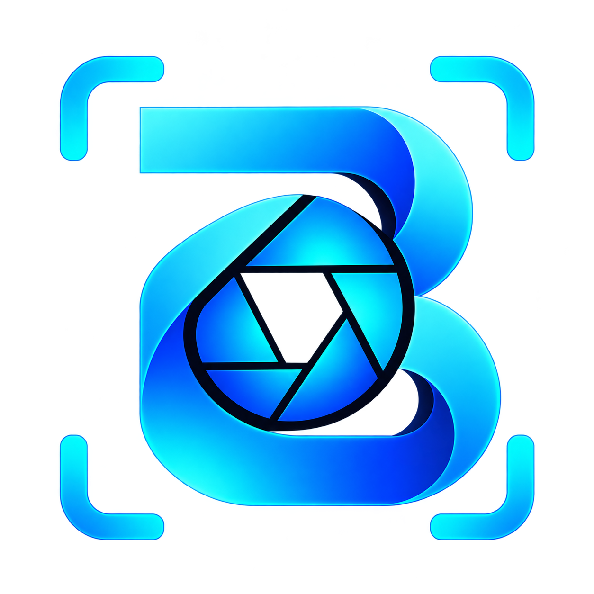

# BoringSS Studio

**Smart Lecture Recording, Auto-Slide Capture & Study Export Suite for Windows**

*Built by [FourLoops](https://github.com/fourloops-dev)*

[Platform](https://github.com/fourloops-dev/boringss-releases)
[Version](https://github.com/fourloops-dev/boringss-releases/releases/latest)
[Framework](https://github.com/fourloops-dev/boringss-releases/releases/latest)

[Download Installer (v4.2.0)](https://github.com/fourloops-dev/boringss-releases/releases/latest) · [Features](#key-features) · [Installation](#installation) · [Plans & Licensing](#plans--licensing) · [Support](#support--contact)

---

## Overview

**BoringSS Studio** is a lightweight, high-performance Windows desktop suite designed for students, educators, and professionals who record online lectures, presentations, coding sessions, or tutorials. Instead of manually taking screenshots or scrubbing through hours of video, BoringSS captures synchronized high-FPS video and automatically detects unique slide changes—exporting everything into a printable **PDF Study Handout** and an **Interactive HTML Study Workspace**.

---

## Key Features

- **Hybrid Lecture Capture (Video + Auto-Slides):** Records smooth, audio-synchronized 60–120 FPS MP4 video while simultaneously snapping unique slides using a 128-bit perceptual dHash duplicate filter.
- **App Focus Studio:** Locks capture directly onto a single application window (such as Zoom, Teams, Chrome, or PowerPoint) so background windows and notifications never clutter your recording.
- **Precision Capture Zones:** Pixel-accurate **Select Region**, **Exclusion Mask Area** (blocks distracting chat boxes or tickers from both recordings and slide detection), and **Pin Snippet** for floating formula/code references.
- **Live Screen Monitor:** Ultra-low-latency, OBS-style real-time monitor with live visual delta metering.
- **Live Annotation Studio:** Draw arrows, highlights, boxes, circles, numbered step badges, and callout notes directly on captured frames.
- **Studio Tools:** Includes a draggable **Webcam PiP Overlay**, **Scheduled Auto-Timer**, **Custom Brand Watermark**, **Compact Mini Bar**, and **PC Hardware Optimizer**.
- **Automatic Study Exports:** Automatically generates a **Printable PDF Study Handout** and an **Interactive HTML Study Workspace** (linked to your recorded video timestamps) the moment your session finishes.
- **Built-in Crash Recovery:** Automatically protects long sessions (tested across 3+ hour continuous recordings) against unexpected interruptions.

---

## Installation

> **System Requirements:** Windows 10 or Windows 11 (64-bit) · 4 GB RAM minimum (8 GB recommended) · ~250 MB free disk space.

### Recommended: One-Click Setup Wizard
1. Go to the [Latest Release](https://github.com/fourloops-dev/boringss-releases/releases/latest) page.
2. Download **`BoringSS_Setup_v4.2.0.exe`**.
3. Run the installer and follow the setup wizard. It installs BoringSS Studio cleanly to `C:\FourLoops\BoringSS`, creates Desktop & Start Menu shortcuts, and registers the official uninstaller in Windows Installed Apps.

### Alternative: Portable ZIP Package
1. Download **`BoringSS_Customer_Setup.zip`** from the [Latest Release](https://github.com/fourloops-dev/boringss-releases/releases/latest) page.
2. Extract the archive to any folder and launch **`BoringSS.exe`**.

> **Windows SmartScreen Note:** Because BoringSS Studio is independently published by FourLoops, Windows Defender SmartScreen may show a prompt on first launch. Click **More info → Run anyway** to proceed.

---

## Plans & Licensing

BoringSS Studio includes a built-in free trial so you can test the workflow before activating a commercial license:

| Tier | Duration | Highlights |
| :--- | :--- | :--- |
| **Free Trial** | 15 Actions | Test core capture, slide detection, and studio tools |
| **Plus** | 30 Days | Full capture suite, Hybrid mode, and study exports |
| **Pro** | 180 Days | All Studio Tools, App Focus, Live Annotation, and Watermarks |
| **Ultra** | 365 Days | Full suite + priority updates and PC Transfer Studio |

- **Hardware-Bound Activation:** Copy your Machine ID inside *Preferences & License* and contact FourLoops to receive your personal activation key.
- **PC Transfer Studio:** Moving to a new computer? Generate an official `.PDF` / `.TXT` Transfer Certificate inside the app to migrate your active plan and customer details cleanly to your new PC.

---

## Support & Contact

Need a license key, help with installation, or want to report feedback?

- **Email:** fourloops.official.2026@gmail.com
- **Instagram:** [@fourloops.dev](https://www.instagram.com/fourloops.dev)
- **GitHub:** [@fourloops-dev](https://github.com/fourloops-dev)

---

 © 2026 FourLoops. All rights reserved. BoringSS Studio is proprietary commercial software. 

